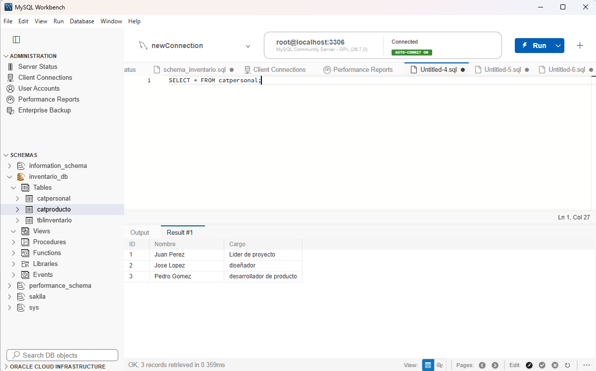
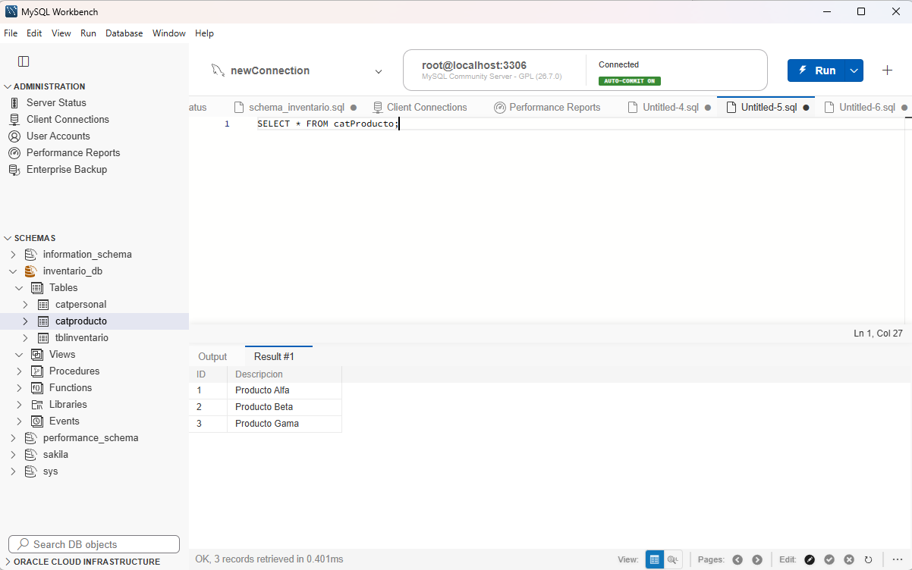
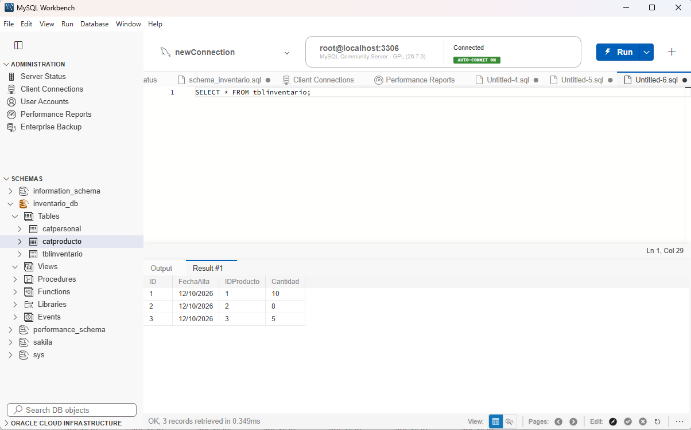
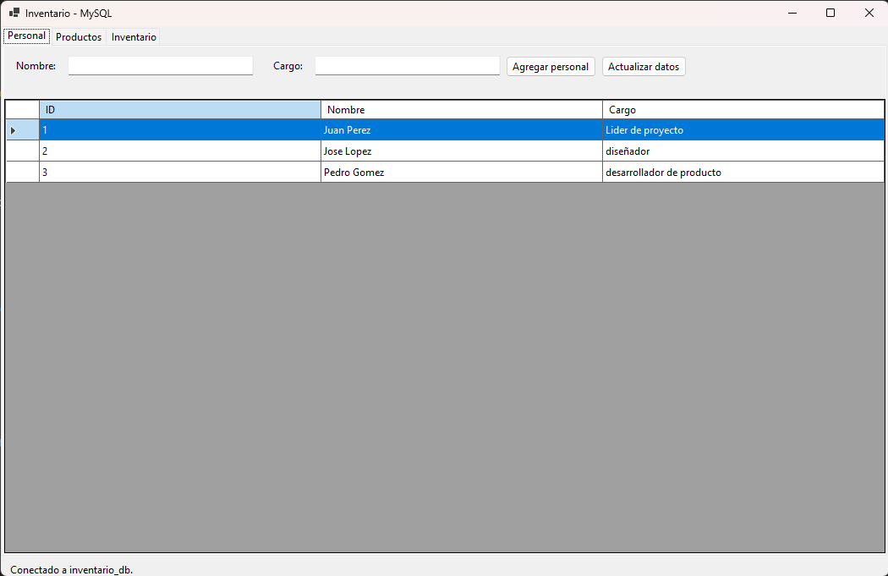
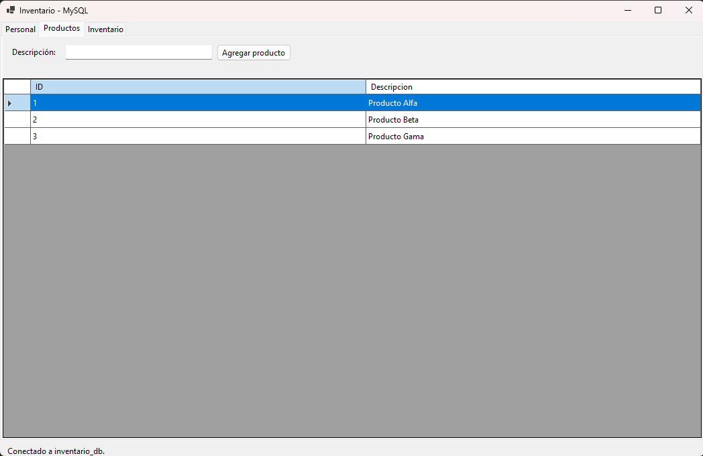
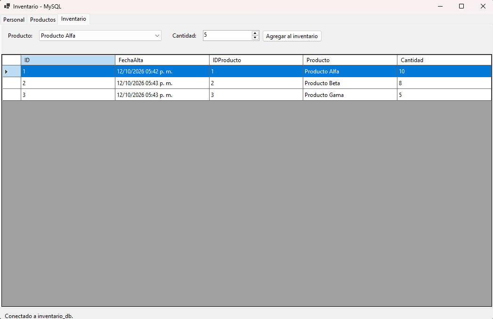

# InteracciónMySQL

Aplicación Windows Forms para interactuar con la base de datos MySQL `inventario_db`. El proyecto está desarrollado con .NET 10 y utiliza `MySqlConnector` para conectarse a MySQL.

## Requisitos

- Windows.
- Visual Studio 2026 o una versión compatible con .NET 10.
- .NET 10 SDK/runtime.
- MySQL Server ejecutándose localmente.
- MySQL Workbench, `mysql` CLI u otra herramienta para ejecutar el script SQL.

## Configuración de la base de datos

La aplicación utiliza la siguiente conexión:

- Servidor: `localhost`
- Puerto: `3306`
- Base de datos: `inventario_db`
- Usuario: `root`
- Contraseña: `ciberdbsql`

1. Inicie el servicio de MySQL.
2. Abra el archivo [`schema_inventario.sql`](schema_inventario.sql).
3. Ejecute el script completo en MySQL. El script crea la base de datos, las tablas y la relación entre productos e inventario.
4. Compruebe que la base de datos `inventario_db` exista antes de iniciar la aplicación.

> Si las credenciales de MySQL son diferentes, actualice `ConnectionString` en `InteracciónMySQL/Form1.cs` antes de ejecutar el proyecto.

## Tablas utilizadas

El formulario trabaja con las tablas definidas en el script:

- `CatPersonal`: almacena `Nombre` y `Cargo`.
- `CatProducto`: almacena la `Descripcion` de cada producto.
- `tblInventario`: almacena la fecha de alta, el producto relacionado y la `Cantidad`.

Los campos `ID` y `FechaAlta` son generados o administrados por MySQL y no se solicitan manualmente en el formulario.

## Ejecución desde Visual Studio

1. Abra `InteracciónMySQL.slnx` en Visual Studio.
2. Restaure los paquetes NuGet si Visual Studio lo solicita.
3. Verifique que `InteracciónMySQL` sea el proyecto de inicio.
4. Ejecute con **Debug > Start Without Debugging** o presione `Ctrl+F5`.
5. La aplicación intentará conectarse automáticamente a `inventario_db`.

También puede compilar desde la terminal, ubicada en la carpeta de la solución:

```powershell
dotnet build
```

## Uso de la aplicación

### Agregar personal

1. Abra la pestaña **Personal**.
2. Escriba un nombre de hasta 80 caracteres.
3. Escriba un cargo de hasta 80 caracteres.
4. Presione **Agregar personal**.
5. El registro aparecerá en la tabla inferior.

### Agregar un producto

1. Abra la pestaña **Productos**.
2. Escriba una descripción de hasta 40 caracteres.
3. Presione **Agregar producto**.
4. El producto aparecerá en la tabla y estará disponible en el selector de inventario.

### Agregar una entrada al inventario

1. Abra la pestaña **Inventario**.
2. Seleccione un producto existente.
3. Introduzca una cantidad mayor que cero.
4. Presione **Agregar al inventario**.
5. La entrada aparecerá en la tabla inferior con la fecha generada por MySQL.

Use **Actualizar datos** para volver a cargar la información desde la base de datos.

## Validación e integridad de datos

La aplicación protege los datos mediante:

- Comandos SQL parametrizados.
- Validación de campos obligatorios.
- Límites de longitud coincidentes con el esquema SQL.
- Control de cantidades positivas.
- Selección únicamente de productos existentes.
- Restricción de clave foránea definida por MySQL.
- Generación automática de `ID` y `FechaAlta` por la base de datos.
- Mensajes para errores de conexión, autenticación, tablas inexistentes y claves foráneas inválidas.

## Solución de problemas

### La base de datos no existe

Ejecute `schema_inventario.sql` y vuelva a iniciar la aplicación.

### No se puede conectar a MySQL

Compruebe que:

- El servicio de MySQL esté iniciado.
- MySQL escuche en el puerto `3306`.
- El usuario `root` y la contraseña sean correctos.
- El firewall permita la conexión local.

### No aparece ningún producto para el inventario

Agregue al menos un producto desde la pestaña **Productos** y presione **Actualizar datos**.

### Error al agregar inventario

Compruebe que el producto seleccionado todavía exista y que la cantidad sea mayor que cero.

## Estructura principal del proyecto

- `InteracciónMySQL/Form1.cs`: conexión, consultas, validación e inserciones.
- `InteracciónMySQL/Form1.Designer.cs`: controles y diseño del formulario.
- `InteracciónMySQL/InteracciónMySQL.csproj`: configuración del proyecto y dependencia MySQL.
- `schema_inventario.sql`: creación de la base de datos y sus tablas.

## Evidences

Las siguientes capturas muestran la creación de las tablas y el funcionamiento del formulario:

### Evidencia 1: Tabla `CatPersonal`



### Evidencia 2: Tabla `CatProducto`



### Evidencia 3: Tabla `tblInventario`



### Evidencia 4: Registros de personal



### Evidencia 5: Registros de productos



### Evidencia 6: Registros de inventario


